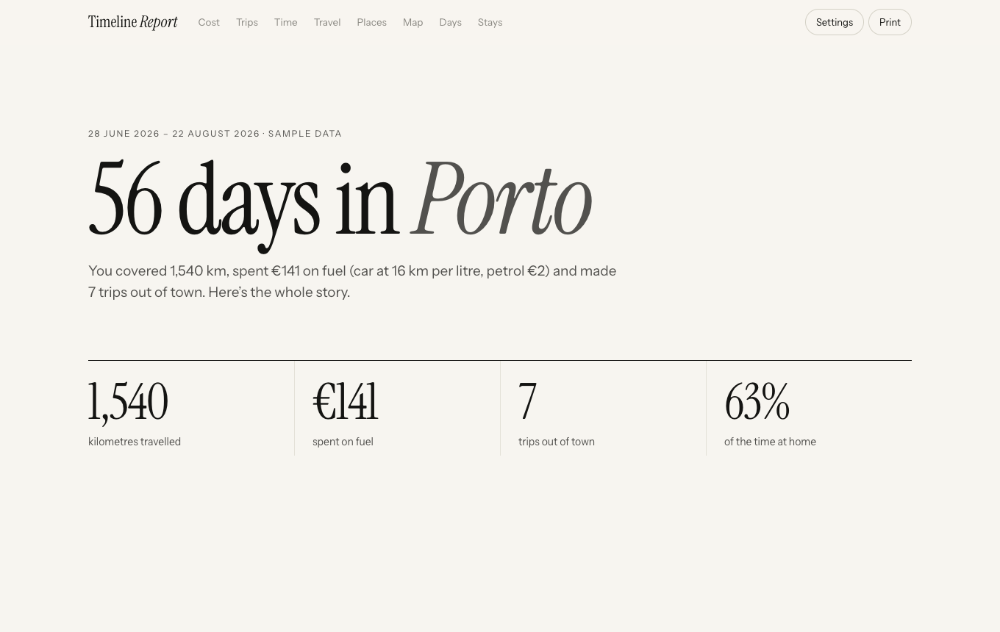
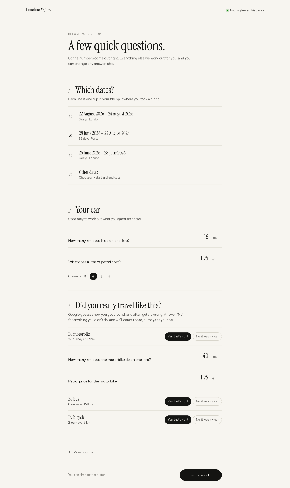
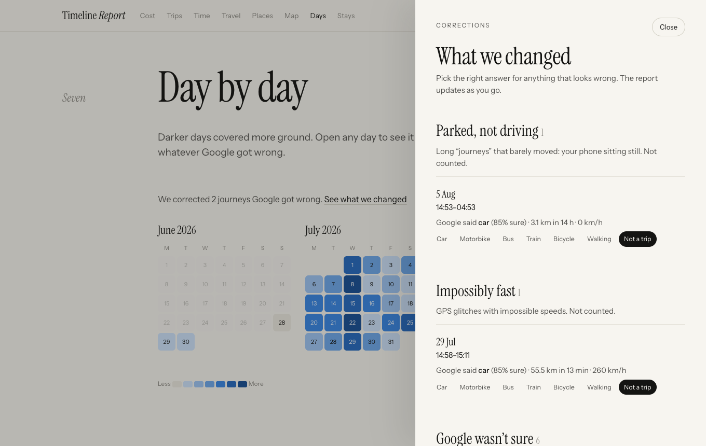
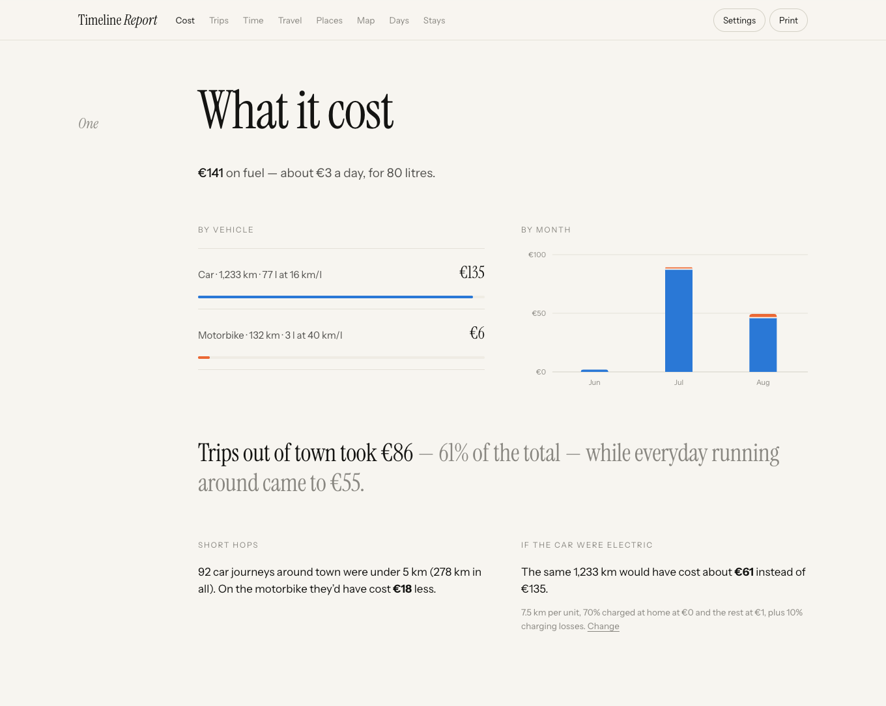
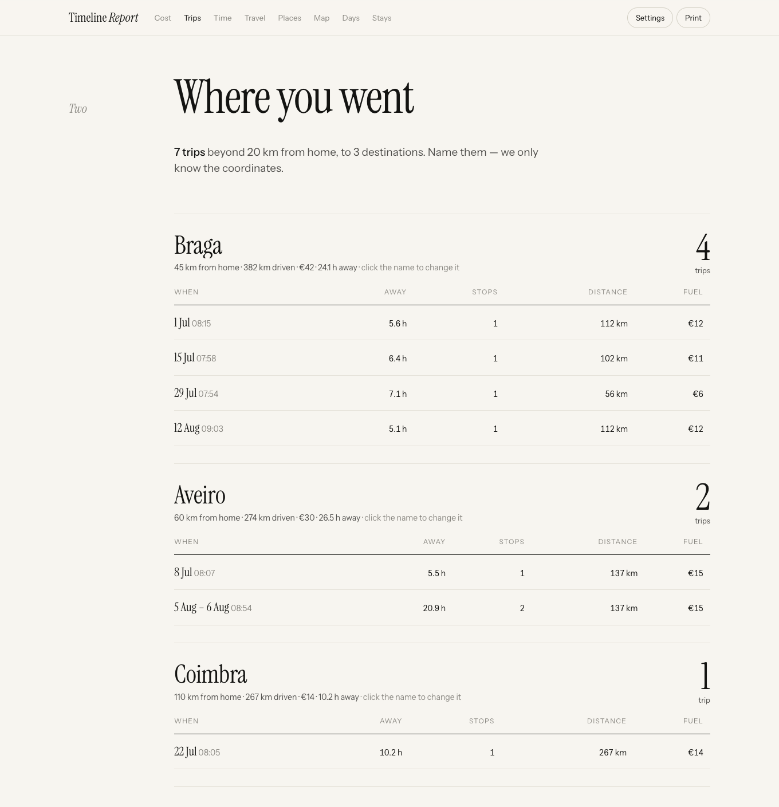
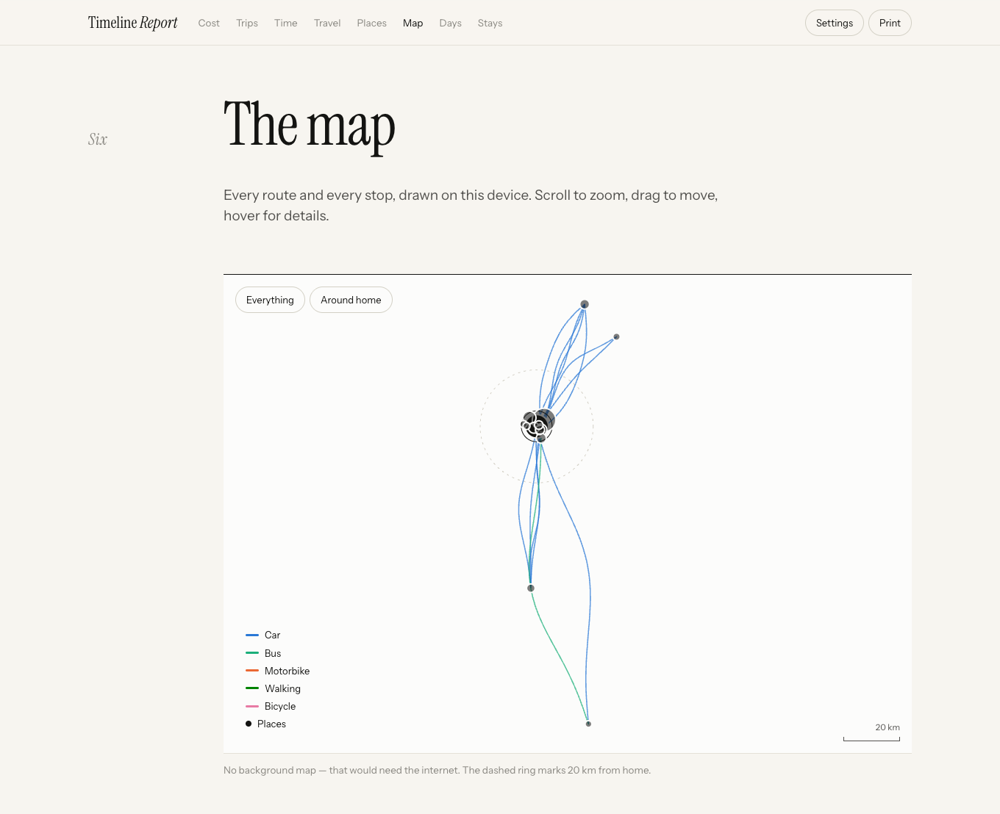
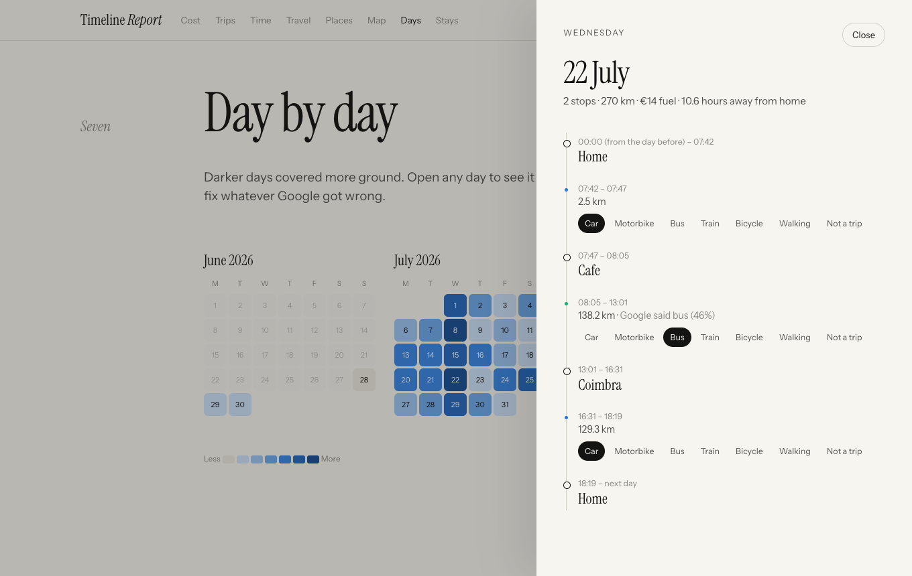

# Timeline Report

**Your Google Maps Timeline, turned into a private report: what you spent on fuel, where you went, and how your days were really spent. Runs offline in your browser. Nothing is uploaded.**

<p align="center"></p>

Google's own Timeline shows you dots on a map. Timeline Report asks three plain questions on one page (which dates, your car's mileage and petrol price, and whether Google's travel guesses are right), fixes the mistakes Google makes, and answers the questions people actually have:

- **What did it cost?** Fuel per vehicle, per month and per trip, plus what an electric car would have cost.
- **Where did I go?** Every trip out of town, grouped by destination ("4 trips to Braga, 382 km").
- **Where did the hours go?** Time at home, around town, away and on the road, week by week, plus when you usually left home and came back.
- **Which places matter?** Your regular spots, labelled with the nearest town or neighbourhood ("Kurumbapet", "Alandur, Chennai") from a built-in offline list. Rename any of them, or open them in Google Maps to check.
- **Day by day:** a calendar of your stay. Open any day to see it hour by hour and correct it.
- **Where have I been?** Stays split by flights with calendar-day counts, useful as supporting evidence for residency or visa day counts.

**Try it:** [open Timeline Report](https://mugeshgithub.github.io/timeline-report/) and click *Explore with sample data*. You can also download [`docs/index.html`](docs/index.html) and open the file directly; it works with no internet connection.

## Private by design

- **One file, no server.** Everything happens in your browser tab.
- **Can't phone home.** The page ships with a Content Security Policy that blocks every network request (`connect-src 'none'`), so your location history physically cannot leave your device. Fonts are embedded.
- **No accounts, no tracking, no AI, no API keys.** Every number comes from plain, readable rules in [`src/js/analyze.js`](src/js/analyze.js).
- **Your corrections stay local.** Place names and fixes are saved in your browser's local storage, keyed to your file.

## It fixes what Google gets wrong

Google guesses how you travelled, and it often guesses wrong. Timeline Report:

- **Asks whether Google's guesses are right.** "By bus: 7 journeys, 139 km. Yes, that's right / No, it was my car." Answer no and those journeys count as your car.
- **Catches parked "drives".** A 16-hour "car journey" covering 3 km is your phone sitting still, so it's excluded.
- **Catches GPS glitches.** A 260 km/h car journey is excluded.
- **Lists low-confidence guesses** so you can fix them with one click. You can also correct any journey from the day view.

<p align="center"></p>

Everything it changed is listed under *See what we changed*, where you can undo or adjust any of it.

<p align="center"></p>

<table><tr>
<td></td>
<td></td>
</tr><tr>
<td></td>
<td></td>
</tr></table>

All screenshots use the built-in sample data: a made-up person in Porto. Nothing in this repository is real location data.

## Getting your Timeline file

Google now keeps Timeline on your phone, so the export comes from there:

- **Android:** Settings → Location → Location services → Timeline → **Export Timeline data**
- **iPhone:** Google Maps → your profile picture → Your Timeline → ⋯ → Location and privacy settings → **Export Timeline data**

Move `Timeline.json` to your computer and drop it onto the page.

| Format | Status |
|---|---|
| Android on-device export (`semanticSegments`) | Supported |
| iPhone on-device export | Experimental. Please [open an issue](../../issues) if it misreads your file |
| Old Google Takeout (`Records.json`, `Semantic Location History`) | Not supported yet |

## How the numbers are worked out

- **Home:** where you spent the most nights, or the place Google labelled home. You can change it.
- **Report window:** from your first arrival home to your last departure. You can change it.
- **Out of town:** any journey that goes more than *N* km from home (20 km by default). Consecutive out-of-town journeys and stops form one trip, and trips are grouped into destinations within 25 km of each other.
- **Fuel:** distance ÷ your mileage × your fuel price, separately for car and motorbike.
- **Electric car comparison:** car distance ÷ km per kWh × a blend of home and public charging prices, plus 10% charging losses.
- **Days:** split at local midnight in the stay's time zone. "Daily rhythm" treats a day as running from 04:00 to 04:00, so late nights count as the day before.

Google's locations are estimates. Treat the report as a good picture of your stay, not as legal proof.

## Development

There are no dependencies; you only need Node.js to bundle the files.

```sh
node scripts/build.js      # bundles src/ into docs/index.html (fonts, CSS and JS inlined)
```

```
src/index.html      page skeleton
src/styles.css      all styles (light and dark)
src/js/parse.js     reads Android / iPhone exports into one shape
src/js/analyze.js   all the numbers: pure functions, no DOM
src/js/geo.js       offline place names (nearest town) from src/js/gazetteer.js
src/js/viz.js       hand-built SVG charts and the offline map
src/js/app.js       setup questions, review, report, day drawer, CSV export
src/js/sample.js    generator for the fake sample data
sample/             the generated sample file, for testing
```

`analyze.js` and `parse.js` have no browser dependencies, so you can run them in Node against your own file.

## Related projects

If you want a map-first viewer rather than a report, these are worth a look:

- [kurupted/google-maps-timeline-viewer](https://github.com/kurupted/google-maps-timeline-viewer) is a full-featured viewer with trip detection and summaries. It uses a Google API key for maps and place names.
- [Robert-Hughes/google-timeline-viewer](https://github.com/Robert-Hughes/google-timeline-viewer) is a standalone offline map and heat map.
- [Dawarich](https://dawarich.app) is a self-hosted location history app.

## Licence

Code: [MIT](LICENSE). Town and city names: [GeoNames](https://www.geonames.org) `cities15000`, CC BY 4.0, rebuilt with `node scripts/make-gazetteer.js cities15000.txt`. Fonts: [Instrument Serif](https://github.com/Instrument/instrument-serif) and [Instrument Sans](https://github.com/Instrument/instrument-sans), SIL Open Font License 1.1 (see [`src/fonts`](src/fonts)).

Not affiliated with Google.
